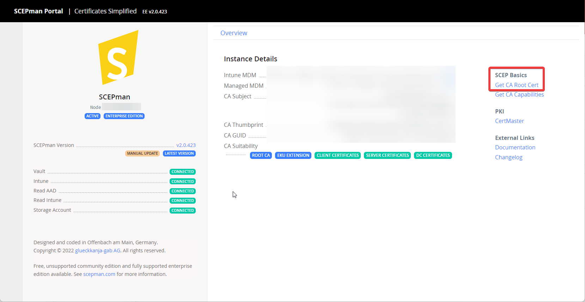

# Computers

Deploy a device certificate to macOS computers through a Jamf Pro configuration profile. First complete the [general.md](general.md "mention").


Add the trusted certificate and SCEP payloads to one configuration profile. This keeps deployment and renewal together.


## Create the configuration profile

In Jamf Pro, create a **macOS Configuration Profile**. Configure the following payloads before scoping the profile.

### Add the trusted root certificate

Download the SCEPman CA certificate from the SCEPman dashboard.

Add the **Certificate** payload. Give it a meaningful name, select **Upload**, and upload the CA certificate. Enable **Allow all apps access**.

.png>)

### Add the device certificate

Add the **SCEP** payload. Enable **Use the External Certificate Authority settings to enable Jamf Pro as SCEP proxy for this configuration profile**.

| Field                      | Purpose                                         | Example                                        |
| -------------------------- | ----------------------------------------------- | ---------------------------------------------- |
| Name                       | Certificate purpose                             | `Device Authentication`                        |
| Redistribute Profile       | Profile renewal interval                        | `14 days`                                      |
| Subject                    | Subject for certificate, additions are possible | CN=$JSSID,OU=computers,CN=$PROFILE\_IDENTIFIER |
| Allow export from keychain | Private-key export                              | No                                             |
| Allow all apps access      | Certificate access                              | Yes                                            |

Adjust the remaining payload options for your certificate use case. Scope the profile to the computers that require the certificate.

<figure><figcaption></figcaption></figure>

### Verify deployment

Use **Keychain Access** on the target Mac. Check the **System** keychain for both certificates. Jamf Pro also reports the profile status.

.png>)

.png>)
