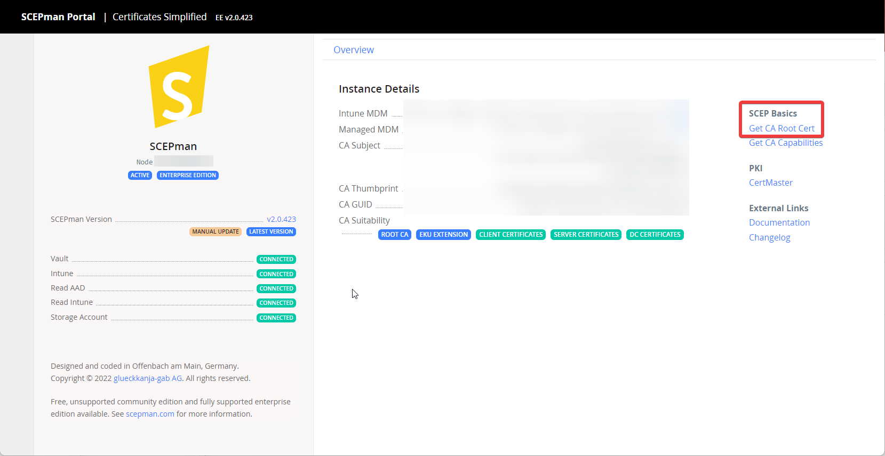

# Devices

Deploy a device certificate to iOS and iPadOS devices through a Jamf Pro configuration profile. First complete the [general.md](general.md "mention").


Add the trusted certificate and SCEP payloads to one configuration profile. This keeps deployment and renewal together.


## Create the configuration profile

In Jamf Pro, create a **Mobile Device Configuration Profile**. Configure the following payloads before scoping the profile.

### Add the trusted root certificate

Download the SCEPman CA certificate from the SCEPman dashboard.

Add the **Certificate** payload. Give it a meaningful name, select **Upload**, and upload the CA certificate.

.png>)

### Add the device certificate

Add the **SCEP** payload. Enable **Use the External Certificate Authority settings to enable Jamf Pro as SCEP proxy for this configuration profile**.

| Field                | Purpose                                         | Example                                      |
| -------------------- | ----------------------------------------------- | -------------------------------------------- |
| Name                 | Certificate purpose                             | `Device Authentication`                      |
| Redistribute Profile | Profile renewal interval                        | `14 days`                                    |
| Subject              | Subject for certificate, additions are possible | CN=$JSSID,OU=devices,CN=$PROFILE\_IDENTIFIER |

Adjust the remaining payload options for your certificate use case. Scope the profile to the target devices.

<figure><figcaption></figcaption></figure>
