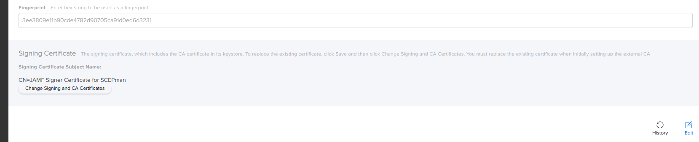

# General Configuration

Connect Jamf Pro to SCEPman as an external CA. Jamf Pro proxies SCEP requests from enrolled users and devices to SCEPman's dedicated `/jamf` endpoint.

## 1. Enable the Jamf endpoint

Set these application settings on the **SCEPman App Service**. Do not set them on Certificate Master.

| Setting                                                                                                                                                                                              | Description                                                                                                                                                                                                                                                       | Example                     |
| ---------------------------------------------------------------------------------------------------------------------------------------------------------------------------------------------------- | ----------------------------------------------------------------------------------------------------------------------------------------------------------------------------------------------------------------------------------------------------------------- | --------------------------- |
| [AppConfig:JamfValidation:Enabled](../../scepman-configuration/application-settings/scep-endpoints/jamf-validation.md#appconfig-jamfvalidation-enabled)                                              | Do you want to use SCEPman with Jamf?                                                                                                                                                                                                                             | true                        |
| [AppConfig:JamfValidation:RequestPassword](../../scepman-configuration/application-settings/scep-endpoints/jamf-validation.md#appconfig-jamfvalidation-requestpassword)                              | <p>Jamf authenticates its certificate requests at SCEPman with this secure password.</p><p>Consider adding this as a secret in your SCEPman <a href="../../scepman-configuration/application-settings/#secure-configuration-in-azure-key-vault">KeyVault</a>.</p> | max _32 character password_ |
| [AppConfig:JamfValidation:ValidityPeriodDays](../../scepman-configuration/application-settings/scep-endpoints/jamf-validation.md#appconfig-jamfvalidation-validityperioddays) (optional)             | How many days shall certificates issued via Jamf be valid at most?                                                                                                                                                                                                | 365                         |
| [AppConfig:JamfValidation:EnableCertificateStorage](../../scepman-configuration/application-settings/scep-endpoints/jamf-validation.md#appconfig-jamfvalidation-enablecertificatestorage) (optional) | Enable this setting to save Jamf certificates in Certificate Master                                                                                                                                                                                               | true or false (default)     |

## 2. Configure the Jamf API connection

SCEPman uses the Jamf API to check enrolled-client status. This enables revocation when Jamf objects are deleted.

[Refer to the Jamf documentation](https://learn.jamf.com/en-US/bundle/jamf-pro-documentation-current/page/API_Roles_and_Clients.html) on how to create an API role and API client. The API client must have a role with these permissions:

* Read Mobile Devices
* Read Computers
* Read User

Set these application settings on the **SCEPman App Service**:

| Setting                                                                                                                                                           | Description                                                                                                                                                                                                                               | Example                                                                                                                                    |
| ----------------------------------------------------------------------------------------------------------------------------------------------------------------- | ----------------------------------------------------------------------------------------------------------------------------------------------------------------------------------------------------------------------------------------- | ------------------------------------------------------------------------------------------------------------------------------------------ |
| [AppConfig:JamfValidation:URL](../../scepman-configuration/application-settings/scep-endpoints/jamf-validation.md#appconfig-jamfvalidation-url)                   | The URL of your Jamf instance                                                                                                                                                                                                             | `https://contoso.jamfcloud.com`                                                                                                            |
| [AppConfig:JamfValidation:ClientID](../../scepman-configuration/application-settings/scep-endpoints/jamf-validation.md#appconfig-jamfvalidation-clientid)         | The identifier of the Jamf API client                                                                                                                                                                                                     | See [Jamf ClientId](https://learn.jamf.com/en-US/bundle/jamf-pro-documentation-current/page/API_Roles_and_Clients.html#ariaid-title3)      |
| [AppConfig:JamfValidation:ClientSecret](../../scepman-configuration/application-settings/scep-endpoints/jamf-validation.md#appconfig-jamfvalidation-clientsecret) | <p>The Client Secret value for the API Client configuration.</p><p>Consider adding this as a secret in your SCEPman <a href="../../scepman-configuration/application-settings/#secure-configuration-in-azure-key-vault">KeyVault</a>.</p> | See [Jamf Client Secret](https://learn.jamf.com/en-US/bundle/jamf-pro-documentation-current/page/API_Roles_and_Clients.html#ariaid-title4) |


Use an API client with `ClientID` and `ClientSecret`. Legacy API username and password settings remain available for compatible deployments.


## 3. Connect the External CA

In Jamf Pro, open **Settings → Global Management → PKI Certificates**.

.png>)

Open **Management Certificate Template → External CA** and enable **SCEP Proxy for configuration profiles**.

.png>)

Complete the following fields, then save the configuration:

| Field                    | Description                                            | Example/Value                                                                                                                                                             |
| ------------------------ | ------------------------------------------------------ | ------------------------------------------------------------------------------------------------------------------------------------------------------------------------- |
| **URL**                  | SCEPman URL. Include the `/jamf` path.                 | [https://scepman.contoso.com/jamf](https://scepman.contoso.com/jamf)                                                                                                      |
| **Name**                 | name of instance                                       | SCEPman Contoso                                                                                                                                                           |
| **Subject**              | entities following X.500 standard                      | O=Contoso                                                                                                                                                                 |
| **Challenge Type**       | challenge type for verification of certificate issuing | Static                                                                                                                                                                    |
| **(Verify) Challenge**   | pre-shared secret (challenge)                          | defined in SCEPman via [AppConfig](../../scepman-configuration/application-settings/scep-endpoints/jamf-validation.md#appconfig-jamfvalidation-requestpassword) parameter |
| Key Size                 | key size in bits                                       | 2048                                                                                                                                                                      |
| Use as digital signature |                                                        | Yes (if needed)                                                                                                                                                           |
| Use for key encipherment |                                                        | Yes (if needed)                                                                                                                                                           |
| Fingerprint              | Thumbprint of SCEPman CA-Cert (SHA-1)                  | visible via SCEPman dashboard ("CA Thumbprint")                                                                                                                           |


## 4. Upload signing and CA certificates

Jamf requires a signing certificate and the SCEPman CA certificate. Jamf signs requests with the signing certificate. SCEPman validates the configured challenge password.



```shellscript
openssl req -x509 -newkey rsa:4096 -keyout tempKey.key -out tempCert.pem -sha256 -days 3650 -nodes -subj "/CN=JAMF Signer Certificate for SCEPman"
openssl pkcs12 -export -out SigningCert.pfx -inkey ./tempKey.key -in ./tempCert.pem -passout pass:password
# Remove temporary files
rm tempKey.key
rm tempCert.pem
```



```powershell
$cert = New-SelfSignedCertificate -Subject "CN=JAMF Signer Certificate for SCEPman" -CertStoreLocation "Cert:\CurrentUser\My" -NotAfter (Get-Date).AddYears(10)
$pfxBytes = $cert.Export([System.Security.Cryptography.X509Certificates.X509ContentType]::Pfx, "password")
[System.IO.File]::WriteAllBytes("c:\temp\jamf.pfx", $pfxBytes)
```



Select **Change Signing and CA Certificates** in the Jamf external CA configuration.



In the wizard, upload the signing-certificate PFX file. Enter its password and confirm the signing certificate. Under **Upload CA Certificate**, upload the SCEPman CA certificate. Download it with **Get CA Certificate** on the SCEPman homepage. Confirm the changes.
