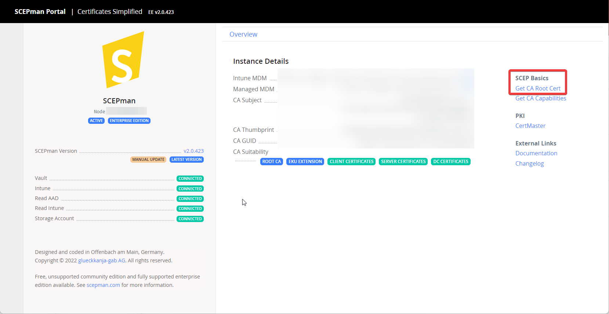

# Users

Deploy user certificates to macOS, iOS, and iPadOS users. First complete the [general.md](general.md "mention").


Add the trusted certificate and SCEP payloads to one configuration profile.



Populate **User and Location** data on target devices. Each user needs an email address, which identifies the user.


## Create the configuration profile

Create the appropriate macOS or mobile-device configuration profile. Add the trusted certificate and SCEP payloads before scoping the profile.

### Add the trusted root certificate

Deploy the SCEPman root certificate if it is not already trusted. Download the CA certificate from the SCEPman dashboard.

Add a **Certificate** payload, select **Upload**, and upload the CA certificate.

.png>)

## User certificates on computers


Jamf Pro can only deploy user certificates to **MDM-enabled users**. There are some provisioning/pre-stage scenarios in which such user accounts are not created. For further information, please refer to the [Jamf Pro documentation](https://docs.jamf.com/10.33.0/jamf-pro/administrator-guide/MDM-Enabled_Local_User_Accounts.html).


Under **Computers → Configuration Profiles**, create a macOS configuration profile. Set **Level** to **User Level**. Add a **SCEP** payload and enable the external CA setting.

| Field                          | Purpose                                         | Value/Example                                           |
| ------------------------------ | ----------------------------------------------- | ------------------------------------------------------- |
| Name                           | Certificate purpose                             | `User Authentication`                                   |
| Redistribute Profile           | Profile renewal interval                        | `14 days`                                               |
| Subject                        | subject for certificate, additions are possible | CN=$JSSID,OU=users-on-computers,CN=$PROFILE\_IDENTIFIER |
| Subject Alternative Name Type  | Subject Alternative Name format                 | RFC 822 Name                                            |
| Subject Alternative Name Value | User email address included in the certificate  | $EMAIL                                                  |

Scope the profile to the target users.

## User certificates on devices

Under **Devices → Configuration Profiles**, create a mobile device configuration profile. Keep **Level** set to **Device Level**, because User Level does not support SCEP. Add a **SCEP** payload and enable the external CA setting.

| Field                          | Purpose                                         | Value/Example                                         |
| ------------------------------ | ----------------------------------------------- | ----------------------------------------------------- |
| Name                           | Certificate purpose                             | `User Authentication`                                 |
| Redistribute Profile           | Profile renewal interval                        | `14 days`                                             |
| Subject                        | subject for certificate, additions are possible | CN=$JSSID,OU=users-on-devices,CN=$PROFILE\_IDENTIFIER |
| Subject Alternative Name Type  | Subject Alternative Name format                 | RFC 822 Name                                          |
| Subject Alternative Name Value | User email address included in the certificate  | $EMAIL                                                |

Scope the profile to the target devices.
