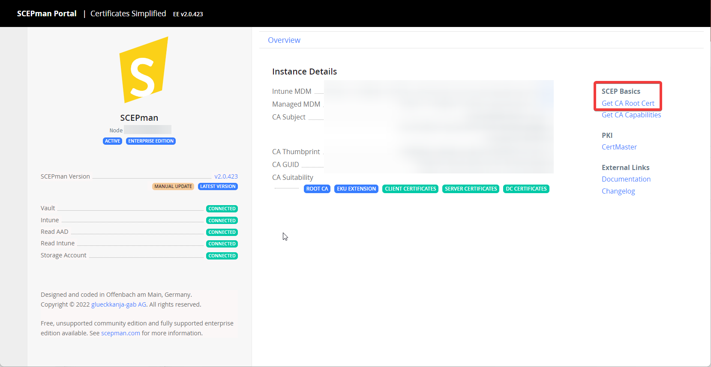

# Addigy

SCEPman can be integrated with [Addigy](https://addigy.com/) as an External Certificate Authority (CA). With a configured challenge password, enrolled devices can request and obtain certificates.

For more general information about other MDM solutions and SCEPman integration, please check [here](./).



### Enable Addigy integration

Integration of SCEPman can be easily enabled via the following environment variables on SCEPman App Service:


If Addigy Entra sync is enabled, use [staticaad-validation.md](../../scepman-configuration/application-settings/scep-endpoints/staticaad-validation.md "mention"). It binds certificates to Entra objects and supports automatic revocation when those objects are disabled or deleted.

Use Static validation only when Entra sync is unavailable. Configure your selected endpoint in [#choose-an-endpoint](./#choose-an-endpoint "mention").



You can differentiate between the SCEPman App Service and the Certificate Master by looking for the App Service **without** the "-cm" in its name


<details>

<summary>Static-AAD validation</summary>

Use these settings when Addigy Entra sync is enabled.



</details>

<details>

<summary>Static validation</summary>

Use these settings when Addigy Entra sync is unavailable.

Use the setting names for your App Service operating system.



Linux App Services use double underscores (`__`) instead of colons.

|                                                                                                      Setting                                                                                                     | Description                                                                                                                                                                                                                                                                                             |                     Value                    |
| :--------------------------------------------------------------------------------------------------------------------------------------------------------------------------------------------------------------: | ------------------------------------------------------------------------------------------------------------------------------------------------------------------------------------------------------------------------------------------------------------------------------------------------------- | :------------------------------------------: |
|                        [AppConfig\_\_StaticValidation\_\_Enabled](../../scepman-configuration/application-settings/scep-endpoints/static-validation.md#appconfig-staticvalidation-enabled)                       | Enable 3rd-party validation                                                                                                                                                                                                                                                                             | _**true**_ to enable, _**false**_ to disable |
|                [AppConfig\_\_StaticValidation\_\_RequestPassword](../../scepman-configuration/application-settings/scep-endpoints/static-validation.md#appconfig-staticvalidation-requestpassword)               | <p>Certificate signing requests sent to SCEPman for signing are authenticated with this secure static password<br><br><strong>Recommendation</strong>: Store this secret in <a href="../../scepman-configuration/application-settings/#secure-configuration-in-azure-key-vault">Azure KeyVault</a>.</p> |      _generate a 32 character password_      |
|       [AppConfig\_\_StaticValidation\_\_ValidityPeriodDays](../../scepman-configuration/application-settings/scep-endpoints/static-validation.md#appconfig-staticvalidation-validityperioddays) (optional)       | Days certificates issued via Addigy are valid                                                                                                                                                                                                                                                           |                      365                     |
| [AppConfig\_\_StaticValidation\_\_EnableCertificateStorage](../../scepman-configuration/application-settings/scep-endpoints/static-validation.md#appconfig-staticvalidation-enablecertificatestorage) (optional) | Store requested certificates in the Storage Account, in order to show them in SCEPman Certificate Master                                                                                                                                                                                                | _**true**_ to enable, _**false** to disable_ |



Windows App Services use colons (`:`) in setting names.

|                                                                                                   Setting                                                                                                  | Description                                                                                                                                                                                                                                                                                             |                     Value                    |
| :--------------------------------------------------------------------------------------------------------------------------------------------------------------------------------------------------------: | ------------------------------------------------------------------------------------------------------------------------------------------------------------------------------------------------------------------------------------------------------------------------------------------------------- | :------------------------------------------: |
|                        [AppConfig:StaticValidation:Enabled](../../scepman-configuration/application-settings/scep-endpoints/static-validation.md#appconfig-staticvalidation-enabled)                       | Enable 3rd-party validation                                                                                                                                                                                                                                                                             | _**true**_ to enable, _**false**_ to disable |
|                [AppConfig:StaticValidation:RequestPassword](../../scepman-configuration/application-settings/scep-endpoints/static-validation.md#appconfig-staticvalidation-requestpassword)               | <p>Certificate signing requests sent to SCEPman for signing are authenticated with this secure static password<br><br><strong>Recommendation</strong>: Store this secret in <a href="../../scepman-configuration/application-settings/#secure-configuration-in-azure-key-vault">Azure KeyVault</a>.</p> |      _generate a 32 character password_      |
|       [AppConfig:StaticValidation:ValidityPeriodDays](../../scepman-configuration/application-settings/scep-endpoints/static-validation.md#appconfig-staticvalidation-validityperioddays) (optional)       | Days certificates issued via Addigy are valid                                                                                                                                                                                                                                                           |                      365                     |
| [AppConfig:StaticValidation:EnableCertificateStorage](../../scepman-configuration/application-settings/scep-endpoints/static-validation.md#appconfig-staticvalidation-enablecertificatestorage) (optional) | Store requested certificates in the Storage Account, in order to show them in SCEPman Certificate Master                                                                                                                                                                                                | _**true**_ to enable, _**false** to disable_ |



</details>


After adding or editing SCEPman configuration parameters, you need to restart the App Service.




### Deploy the SCEPman root certificate

As a first step, SCEPman root certificate must be deployed. To do so, download the RootCA certificate via the SCEPman website:



Now convert the .cer root certificate to PEM format in order to upload it to Addigy. You can use the following OpenSSL command for that:

```
openssl x509 -inform der -in scepman-root.cer -out SCEPman-Root-Certificate.pem
```

In Addigy, navigate to **Profiles** and create a new MDM profile, choose **Certificates - (PKCS12)** as Profile Type to upload SCEPman RootCA and upload the PEM format file.

<figure><figcaption></figcaption></figure>



### Create the SCEP profile

The second step is to create a new **SCEP Profile** for device certificate deployment as below:

* **Payload Name:** Choose a name for the profile, this will appear as a certificate profile on the client.
* **URL**: Use the SCEP endpoint that matches your selected validation method. Use `/static/aad` for Static-AAD validation, or `/static` for Static validation. You can copy the URL from the SCEPman homepage.

<figure><figcaption></figcaption></figure>

* **Challenge**: Is required to authenticate CSR requests. It must match the request password configured for [#appconfig-staticaadvalidation-requestpassword](../../scepman-configuration/application-settings/scep-endpoints/staticaad-validation.md#appconfig-staticaadvalidation-requestpassword "mention") or [#appconfig-staticvalidation-requestpassword](../../scepman-configuration/application-settings/scep-endpoints/static-validation.md#appconfig-staticvalidation-requestpassword "mention").


Static-AAD validation requires the certificate subject to include an Entra device ID, or its SAN to include a user's UPN.


* Enable the **"Proxy SCEP Requests"** option
* Choose "Signing & Encryption" for **Key Usage**
* Fill out the rest as shown in the screenshots below

<figure><figcaption></figcaption></figure>

<figure><figcaption></figcaption></figure>

After successfully creating both the Root CA and Device Certificate profiles, apply them to your policy to deploy the configuration to assigned devices.

For more information, please check [Addigy's documentation.](https://support.addigy.com/hc/en-us/articles/4403542430739-Deploying-Certificates)


