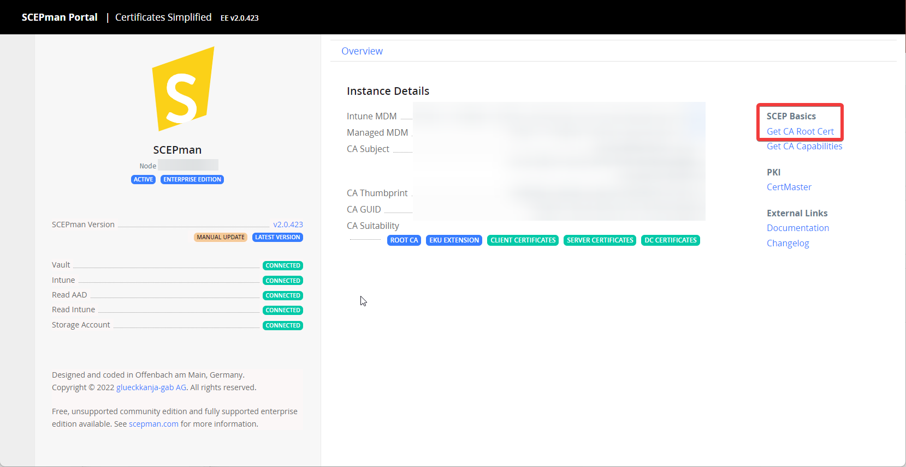

# Iru (formerly Kandji)

SCEPman can be connected to [Iru](https://www.iru.com/) as an External CA with a challenge password, enabling enrolled devices to obtain certificates.

For more general information about other MDM solutions and SCEPman integration, please check [here](./).



### Enable Iru integration

Integration of SCEPman can be easily enabled via the following environment variables on SCEPman App Service:


If Iru Entra sync is enabled, use [staticaad-validation.md](../../scepman-configuration/application-settings/scep-endpoints/staticaad-validation.md "mention"). It binds certificates to Entra objects and supports automatic revocation when those objects are disabled or deleted.

Use Static validation only when Entra sync is unavailable. Configure your selected endpoint in [#choose-an-endpoint](./#choose-an-endpoint "mention").



You can differentiate between the SCEPman App Service and the Certificate Master by looking for the App Service **without** the "-cm" in its name


Static-AAD validation

Use these settings when Iru Entra sync is enabled.



Static validation

Use these settings when Iru Entra sync is unavailable.

Use the setting names for your App Service operating system.



Linux App Services use double underscores (`__`) instead of colons.

|                                                                                                      Setting                                                                                                     | Description                                                                                                                                                                                                                                                                                             |                     Value                    |
| :--------------------------------------------------------------------------------------------------------------------------------------------------------------------------------------------------------------: | ------------------------------------------------------------------------------------------------------------------------------------------------------------------------------------------------------------------------------------------------------------------------------------------------------- | :------------------------------------------: |
|                        [AppConfig\_\_StaticValidation\_\_Enabled](../../scepman-configuration/application-settings/scep-endpoints/static-validation.md#appconfig-staticvalidation-enabled)                       | Enable 3rd-party validation                                                                                                                                                                                                                                                                             | _**true**_ to enable, _**false**_ to disable |
|                [AppConfig\_\_StaticValidation\_\_RequestPassword](../../scepman-configuration/application-settings/scep-endpoints/static-validation.md#appconfig-staticvalidation-requestpassword)               | 
Certificate signing requests sent to SCEPman for signing are authenticated with this secure static password  <strong>Recommendation</strong>: Store this secret in <a href="../../scepman-configuration/application-settings/#secure-configuration-in-azure-key-vault">Azure KeyVault</a>.
 |      _generate a 32 character password_      |
|       [AppConfig\_\_StaticValidation\_\_ValidityPeriodDays](../../scepman-configuration/application-settings/scep-endpoints/static-validation.md#appconfig-staticvalidation-validityperioddays) (optional)       | Days certificates issued via Iru are valid                                                                                                                                                                                                                                                              |                      365                     |
| [AppConfig\_\_StaticValidation\_\_EnableCertificateStorage](../../scepman-configuration/application-settings/scep-endpoints/static-validation.md#appconfig-staticvalidation-enablecertificatestorage) (optional) | Store requested certificates in the Storage Account, in order to show them in SCEPman Certificate Master                                                                                                                                                                                                | _**true**_ to enable, _**false** to disable_ |



Windows App Services use colons (`:`) in setting names.

|                                                                                                   Setting                                                                                                  | Description                                                                                                                                                                                                                                                                                             |                     Value                    |
| :--------------------------------------------------------------------------------------------------------------------------------------------------------------------------------------------------------: | ------------------------------------------------------------------------------------------------------------------------------------------------------------------------------------------------------------------------------------------------------------------------------------------------------- | :------------------------------------------: |
|                        [AppConfig:StaticValidation:Enabled](../../scepman-configuration/application-settings/scep-endpoints/static-validation.md#appconfig-staticvalidation-enabled)                       | Enable 3rd-party validation                                                                                                                                                                                                                                                                             | _**true**_ to enable, _**false**_ to disable |
|                [AppConfig:StaticValidation:RequestPassword](../../scepman-configuration/application-settings/scep-endpoints/static-validation.md#appconfig-staticvalidation-requestpassword)               | 
Certificate signing requests sent to SCEPman for signing are authenticated with this secure static password  <strong>Recommendation</strong>: Store this secret in <a href="../../scepman-configuration/application-settings/#secure-configuration-in-azure-key-vault">Azure KeyVault</a>.
 |      _generate a 32 character password_      |
|       [AppConfig:StaticValidation:ValidityPeriodDays](../../scepman-configuration/application-settings/scep-endpoints/static-validation.md#appconfig-staticvalidation-validityperioddays) (optional)       | Days certificates issued via Iru are valid                                                                                                                                                                                                                                                              |                      365                     |
| [AppConfig:StaticValidation:EnableCertificateStorage](../../scepman-configuration/application-settings/scep-endpoints/static-validation.md#appconfig-staticvalidation-enablecertificatestorage) (optional) | Store requested certificates in the Storage Account, in order to show them in SCEPman Certificate Master                                                                                                                                                                                                | _**true**_ to enable, _**false** to disable_ |




After adding or editing SCEPman configuration parameters, you need to restart the App Service.




### Deploy the SCEPman root certificate

As a first step, you must deploy SCEPman's root certificate. Download this CA certificate via the SCEPman website:

In Iru, navigate to **Library** on the left navigation bar and add a **Certificate Library Item** to your Blueprint.

<figure><figcaption>
Configure a Certificate Payload
</figcaption></figure>

To upload the certificate, first select **PKCS #1-formatted certificate** under **Certificate type**, secondly provide an optional name, upload your SCEPman CA certificate, and eventually save it.

<figure><figcaption>
Adding the SCEPman Root CA Certificate
</figcaption></figure>



### Create the SCEP profile

The second step is to add a **SCEP Profile** to your **Blueprint**. Therefore, add a new **SCEP Library Item** and configure it as below:

* **URL**: Use the SCEP endpoint that matches your selected validation method. Use `/static/aad` for Static-AAD validation, or `/static` for Static validation.
* **Name:** An optional SAN attribute
* **Challenge**: Is required to authenticate CSR requests. It must match the request password configured for [#appconfig-staticaadvalidation-requestpassword](../../scepman-configuration/application-settings/scep-endpoints/staticaad-validation.md#appconfig-staticaadvalidation-requestpassword "mention") or [#appconfig-staticvalidation-requestpassword](../../scepman-configuration/application-settings/scep-endpoints/static-validation.md#appconfig-staticvalidation-requestpassword "mention").
* **Fingerprint:** Optional CA fingerprint. It is highly recommended to configure this value as it provides an additional level of security. You can find it on your SCEPman website as **CA Thumbprint**.
* **Subject:** Optional subject name. **CN=$PROFILE\_UUID** will be automatically added from Iru as default common name. Iru allows you to add multiple CNs.


Static-AAD validation requires the certificate subject to include an Entra device ID, or its SAN to include a user's UPN.



Occasionally macOS and iOS had problems auto-selecting client certificates for network authentication purposes when more than two CNs are added.


* **Key Size:** 2048
* **Key Usage:** Both, signing and encryption

For more information, please check [Iru's documentation](https://support.kandji.io/support/solutions/articles/72000559782-scep-profile).

<figure><figcaption>
Adding a SCEP Profile
</figcaption></figure>

<figure><figcaption>
SCEP Profile Configuration
</figcaption></figure>

<figure><figcaption>
SCEP Profile Configuration
</figcaption></figure>

<figure><figcaption>
SCEP Profile Configuration
</figcaption></figure>



### Check deployment status

After saving the certificate or SCEP profile, switch to **Status** to check the deployment status on **Blueprints** assigned devices.

<figure><figcaption>
Deployment Status
</figcaption></figure>


