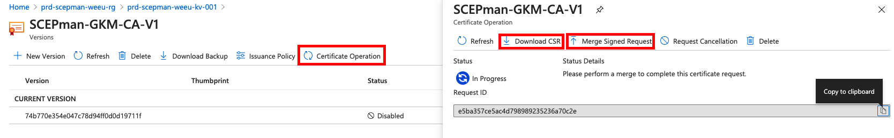

# Intermediate CA


SCEPman Enterprise Edition only


Use an Intermediate CA when another Root CA remains your primary authority. SCEPman creates the key and certificate request in Azure Key Vault. Your Root CA signs the request.

### Before you begin

Complete these prerequisites before creating the certificate:

* Your administrator account can create certificate requests and merge signed certificates in the SCEPman Key Vault.
* A system running Azure CLI and PowerShell can reach the Key Vault.
* You know the required intermediate CA subject and certificate name.

<details>

<summary>Grant Key Vault certificate permissions</summary>



1. In the Key Vault, open **Access control (IAM)** → **Role assignments**.
2. Add the **Key Vault Certificate Officer** role.
3. Assign the role to the administrator account that creates the CSR.

<figure><figcaption><p>Add a role assignment in the Key Vault.</p></figcaption></figure>

<figure><figcaption><p>Select the Key Vault Certificate Officer role.</p></figcaption></figure>



1. In the Key Vault, open **Access policies** and select **Create**.
2. Select the **Certificate Management** template.
3. Assign the policy to the administrator account that creates the CSR.

<figure><figcaption></figcaption></figure>

<figure><figcaption></figcaption></figure>

<figure><figcaption></figcaption></figure>



</details>

<details>

<summary>Allow network access to Key Vault</summary>

If your Key Vault uses [private-endpoints.md](../azure-configuration/private-endpoints.md "mention"), allow the workstation or Cloud Shell environment used below. Without this access, the module cannot create the CSR or merge the certificate.

In the Key Vault, open **Settings** → **Networking**. Allow the relevant virtual network or client IP address. A VNet-connected [Azure Cloud Shell](https://learn.microsoft.com/en-us/azure/cloud-shell/vnet/overview) is also supported. Remove temporary network exceptions after the certificate is merged.

</details>

### Create the Intermediate CA



#### Configure the SCEPman certificate settings

In the SCEPman App Service, open **Environment variables**. Under **Application settings**, update:

* `AppConfig:KeyVaultConfig:RootCertificateConfig:CertificateName`: the Key Vault certificate name. Use letters, numbers, and dashes only.
* `AppConfig:KeyVaultConfig:RootCertificateConfig:Subject`: change only the `CN` to the same common name.

Select **Apply** and confirm the changes. **Restart** the App Service. Then open the SCEPman URL.

<figure><figcaption></figcaption></figure>



#### Create the certificate request

Use SCEPman PowerShell module version 1.9 or later. [Azure Cloud Shell](https://learn.microsoft.com/en-us/azure/cloud-shell/overview) is recommended because it includes Azure CLI. Otherwise, install [Azure CLI](https://learn.microsoft.com/en-us/cli/azure/install-azure-cli).

```powershell
Install-Module -Name SCEPman -Scope CurrentUser -Force
```

Set your organization:

```powershell
Reset-IntermediateCaPolicy -Organization "My Organization"
```

Set the subject to the value configured in the App Service. You can also adjust additional policy settings before saving it.


```powershell
$policy = Get-IntermediateCaPolicy
$policy.policy.x509_props.subject = "CN=YOUR_CN_FROM_ABOVE,OU=YOUR_TENANT_ID,O=YOUR_ORGANIZATION"
# change some additional settings of $policy
Set-IntermediateCaPolicy -Policy $policy
```


Create the CSR:

```powershell
New-IntermediateCA -SCEPmanAppServiceName "app-scepman-example" -SearchAllSubscriptions 6>&1
```

The command outputs the CSR for your Root CA.



#### Issue the Intermediate CA certificate

Retrieve the issued certificate from your Root CA. Save it as a Base64-encoded `.cer` file.

<details>

<summary>SCEPman Root CA: submit the CSR through Certificate Master</summary>

Open [certificate-signing-request-csr.md](../certificate-management/certificate-master/certificate-signing-request-csr.md "mention"). Paste the PEM-encoded CSR, or upload the CSR file, to issue the Intermediate CA certificate. Change **Download File format** to **PEM** before downloading the certificate.

</details>

<details>

<summary>ADCS Enterprise Root CA: add Key Encipherment</summary>

This applies only to AD-integrated ADCS Enterprise Root CAs. The certificate must include `CRLSign`, `DigitalSignature`, `KeyEncipherment`, and `KeyCertSign`. The default **Subordinate Certificate Authority** template omits `KeyEncipherment`. Stand-alone and offline Root CAs use the CSR key usages.

1. Request and issue a SubCA certificate. You can duplicate the SubCA template.
2. On the Root CA, export the certificate as Base-64 encoded X.509, for example `C:\temp\SubCA.cer`.
3. Create `C:\temp\extfile.txt`:

```
[Extensions]
2.5.29.15=AwIBpg==
Critical=2.5.29.15
```

4. Run:

```powershell
certutil -sign "C:\temp\SubCA.cer" "C:\temp\SubCAwithKeyEncipher.cer" @C:\temp\extfile.txt
```

The output certificate has key usage `0xA6`. Its signature changes, but its serial number does not. Revoking the original ADCS certificate also revokes the re-signed certificate. Optionally, delete the old entry with `certutil -deleterow` and import the new certificate with `certutil -importcert`.

</details>



#### Merge the signed certificate

In Azure Key Vault, open the certificate and select **Certificate Operation** → **Merge Signed Request**. Upload the issued certificate. The certificate appears under **Completed** when the merge succeeds.




The certificate must use PEM or Base64 encoding. Binary DER encoding causes an `x5c has invalid value` error.




#### Verify the CA

Open the SCEPman status page. Confirm that **CA Suitability** reports no missing requirements. Download the Intermediate CA certificate for deployment through your MDM.

If SCEPman reports that `Key Encipherment` is missing, correct the issued certificate and merge it again.



### Intune SCEP profiles

* **Android:** reference the Root CA.
* **Windows:** reference the Intermediate CA.
* **iOS and macOS:** no conclusive recommendation is available.
